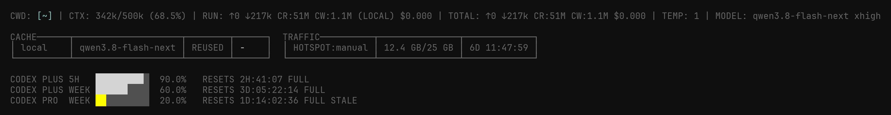

# JACK10-pi-config

My custom [`pi`](https://github.com/earendil-works/pi) harness that I've been building piece by piece.

If you are crazy enough to like what you see, feel free to copy (or portions of) it. I invite you to investigate it, or to ask an LLM what I'm doing here.

## Limitations

Don't expect to clone this and use it. It relies on [my branch of the pi](https://github.com/gojack10/pi-mono) and [my branch of tmux](https://github.com/gojack10/tmux). It also requires a plethora of gitignored stuff. And I don't read the code. It's probably low quality but it works. If you want, have an agent read the code for you.

My harness heavily depends upon [SiftText](https://sifttext.com)

## Public portfolio, local machine

This is the working harness and its public portfolio, not a separately maintained export.
Reusable code and portable templates are tracked. Machine identities, credentials,
private knowledge bindings, deployed infrastructure and run artifacts stay local.
The displayed footer image is intentionally public.

- `APPEND_SYSTEM.md` remains local; `APPEND_SYSTEM.example.md` shows the portable policy.
- `local/knowledge/*.md` are ignored symlinks to this machine's canonical SiftText procedures.
  Resolve them before following relative knowledge links. The skills use these named bindings
  rather than publishing private node IDs. Generated factory prompts resolve the same bindings.
- Knowledge files default to `~/sifttext`; set `SIFTTEXT_HOME` for a different home.
- `local/native-models.json` optionally supplies `args` arrays for already registered native models.
  Keep actual steering paths there; binary qualification and model admission remain in code.
  Changing those settings still requires the normal authorized maintenance procedure.
- `extensions/bf2-swarm/hosting-config/` is the ignored deployment; `hosting-config.example/`
  contains substitutes. Copying a template is not a service restart or hosting authorization.
- `startlux-service/pyproject.toml` and `uv.lock` are installed, machine-local manifests covered
  by artifact pins. Portable `.example` versions remain tracked. Preserve the installed bytes;
  a new installation can use an `upstream` link to its qualified source checkout.
- `factory-runs/` is always ignored. Two existing host-bound fixture files also remain local;
  the reusable implementation and other fixtures stay tracked.

For a new machine, configure the named knowledge bindings required by the skills you use:

```sh
mkdir -p local/knowledge
ln -s "$HOME/sifttext/nodes/LOCAL_NODE_ID/node.md" local/knowledge/git-commit.md
cp APPEND_SYSTEM.example.md APPEND_SYSTEM.md
git config --local core.hooksPath .githooks
```

### Public push review

The pre-push hook pauses the first attempt for each exact outgoing ref/commit set and
remote destination. Review the content and commit messages, then use the printed
`bin/public-push-review safe KEY` command. If private material remains, only use
`jack-approved KEY "specific publication approval"` after Jack explicitly approves
publishing that material. Retry the original push; changed commits or destinations
require a new review. Approval is stored only inside Git's local administrative directory.

The hook is a deliberate agent review stop, not a secret detector or server-side security
boundary. Git can bypass local hooks; GitHub CI cannot prevent disclosure after upload.
Never use a bypass to avoid the review.

# Highlights

## Riced Custom Status Bar



## Router for multiple codex accounts

The codex router follows the account order in the private, untracked `codex-accounts.json`, skipping accounts that lack the model or quota. It checks that order at startup and before each prompt, and switches accounts on a zero-output usage-limit failure. Real responses update the saved quota readings. A shared ten-minute check refreshes idle accounts to catch unexpected resets; cached percentages stay visible without stale badges.

## Custom subagent systemn (WIP)

Ufortunately for my personal preferences Pi's built-in subagent setup wasn't cutting it, I wanted to look at subagent chats via tmux. I started with tmux commands, then wrote custom tools `subagent-launch/` and `task-outcomes/`. They open pi in a pane, wait for it to stop cleanly, then bring the report back into the session.

## Memory and skills

I frequently work through complex problems with agents. [SiftText](https://sifttext.com) is my methodology for efficiently doing so, and my product. `sifttext-mcp/` gives pi the 28 tools that make the interface work. `skills/sifttext-commit/SKILL.md` points to the local SiftText Commit procedure. My skill files are mainly sifttext node pointers.

## Local AI maintenance

`~/.pi/agent/local-ai stop` closes admission, checks chat ownership, drains native
work, stops the engines, then stops the proxy. It refuses active work or unknown
completion instead of force-killing it. Repeating a successful stop is safe.

`~/.pi/agent/local-ai start` reopens the proxy **without loading an engine**.
The next request to `127.0.0.1:8002` selects the engine; models stay warm between
requests, and switches wait for native completion and process exit. Use
`~/.pi/agent/local-ai status` to inspect reception and the resident model.

For a settings change: stop, edit the setting, start, then request the desired
model. Don't restart just the proxy over retained engines or use `launchctl
kickstart -k` as a shortcut. Home Manager's changed-proxy activation uses the
same maintenance commands; it no longer starts Qwen or sends a model request.
The short `local-ai` command is installed by the M5 Home Manager configuration;
the full path works without an activation.

MLX chat workers use the installed, pinned mlx-lm runtime and its serial
worker's native stream synchronization. No experimental MLX build is needed.
Runtime changes require requalifying `mlx-service/pin.json`, not silently
accepting new library bytes. Stop/start is a maintenance command, not permission
to overlap local engines or to interrupt another owning chat.

## Codex desktop

The combined desktop gateway lives at `/backend-api/codex`. Its `/models`
endpoint combines the signed-in user's current OpenAI catalog with managed
local models.
OpenAI inference is forwarded to OpenAI with that user's existing
ChatGPT credential and account header; credentials and prompts are not stored.
The local model `deepseek-v4.1-flash-1017-local` routes to the existing
`deepseek-v4.1-flash` backend. Its ID and menu label use the public alias; Pi's
model identity and native model configuration keep their existing names.
The other managed menu aliases are `glm-5.3-flash-local` and
`qwen3.8-flash-next-local`; each routes to the existing canonical ID without
the `-local` suffix. Existing chats using the canonical IDs still route locally.

For separate local-only clients, the proxy also serves `/v1/responses` and
`/v1/codex/models`. A `/v1/models` request with Codex's `client_version` query
parameter returns the local catalog; ordinary Pi discovery keeps its format.

Codex requests are translated into the existing managed native chat route.
They retain the queue, chat ownership, GPU lease, cancellation and native
completion/release sequence. Text, reasoning, function tools and custom text
tools are supported. Codex must replay full conversation input; stored response
IDs, images and provider-hosted tools are not implemented by the local adapter.
Codex adds hosted web search at the provider level even when a local model is
selected. The adapter omits that declaration only for local inference, tells the
model to use available browser/search functions instead, and preserves function
and custom tools. Explicitly forcing hosted search returns an error rather than
silently changing the requested tool. OpenAI requests keep their hosted search.
Local auxiliary Responses operations, including remote compaction, are rejected
locally rather than forwarding local conversation input to OpenAI.
The local catalog lists the registered managed DwarfStar models. Their reasoning
options are only thinking off (`none`), `high` and `xhigh`; `xhigh` selects native
Think Max. Other requested levels are rejected. OpenAI model capabilities pass
through from OpenAI's catalog.

Keep the built-in `openai` provider so existing OpenAI chats can resume. Set
these top-level keys in the user-level Codex configuration:

```toml
model = "gpt-6.1-sol"
model_provider = "openai"
openai_base_url = "http://127.0.0.1:8002/backend-api/codex"

[features]
enable_request_compression = false
```

The built-in provider discovers the combined catalog at `/models` using existing
ChatGPT sign-in. Do not define a replacement `[model_providers.openai]` table;
Codex reserves that provider ID. A separate combined provider ID prevents
existing `openai` chats from resuming. The gateway returns HTTP 426 on the
Responses WebSocket handshake, which tells Codex to use streamed HTTP for that
session. Request compression is disabled so the gateway can route JSON by model.
The desktop may save the last model selected in its picker; that changes the
model default, not the `openai` provider identity.

The local-only provider instead uses `http://127.0.0.1:8002/v1` and a credential
command reading the existing `.proxy-key`. Local native requests never receive
ChatGPT tokens. Finish running desktop tasks before using Settings > Model
Providers > Reload ChatGPT to load the saved configuration and catalog. Existing
OpenAI chats keep their provider identity and use the configured gateway.

Codex session headers provide chat identity. Ownership stays held across tool
calls and releases after the final answer, an incomplete response or an active
request cancellation. The existing idle lease and authenticated chat-release
operation still cover an abandoned session between model requests.

Activate proxy source changes with the documented `local-ai stop` / `start`
maintenance procedure once the owning chat has finished, from an independent
terminal or Pi session. Both local and OpenAI Codex requests depend on this
process: a Codex chat cannot stop its own gateway and then continue to repair it.
Restarting the proxy alone over a retained engine loses its native ownership
state. Maintenance refuses active local generation; finish cloud gateway requests
before restarting too, since they use the same process. Disconnected cloud
clients cancel their upstream I/O even before output arrives.
Do not bypass a refusal with `launchctl bootout`.

If the gateway is already down, `local-ai start` checks that engines are off and
restores reception without loading a model. A direct-OpenAI recovery is to remove
`openai_base_url`, select an OpenAI model, retain `model_provider = "openai"`, and
reload the desktop after its tasks finish. This temporarily removes the combined
menu, not the saved chats. Restore the gateway URL after maintenance to use local
models again.

## Pi fork

Sometimes Pi can't do certain stuff, so I run [gojack10/pi-mono](https://github.com/gojack10/pi-mono). If you install upstream pi, some extensions will load and do nothing.
