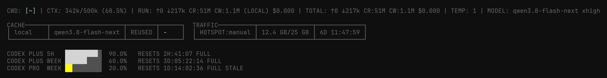

# JACK10-pi-config

My custom [`pi`](https://github.com/earendil-works/pi) harness that I've been building piece by piece.

If you are crazy enough to like what you see, feel free to copy (or portions of) it. I invite you to investigate it, or to ask an LLM what I'm doing here.

## Limitations

Don't expect to clone this and use it. It relies on [my branch of the pi](https://github.com/gojack10/pi-mono) and [my branch of tmux](https://github.com/gojack10/tmux). It also requires a plethora of gitignored stuff. And I don't read the code. It's probably low quality but it works. If you want, have an agent read the code for you.

My harness heavily depends upon [SiftText](https://sifttext.com)

# Highlights

## Riced Custom Status Bar

## Router for multiple codex accounts

The codex router follows the account order in the private, untracked `codex-accounts.json`, skipping accounts that lack the model or quota. It checks that order at startup and before each prompt, and switches accounts on a zero-output usage-limit failure. Real responses update the saved quota readings. A shared ten-minute check refreshes idle accounts to catch unexpected resets; cached percentages stay visible without stale badges.

## Custom subagent systemn (WIP)

Ufortunately for my personal preferences Pi's built-in subagent setup wasn't cutting it, I wanted to look at subagent chats via tmux. I started with tmux commands, then wrote custom tools `subagent-launch/` and `task-outcomes/`. They open pi in a pane, wait for it to stop cleanly, then bring the report back into the session.

## Memory and skills

I frequently work through complex problems with agents. [SiftText](https://sifttext.com) is my methodology for efficiently doing so, and my product. `sifttext-mcp/` gives pi the 28 tools that make the interface work. `sifttext-commit/` turns a finished session into commits in a tree. My skill files are mainly sifttext node pointers.

## Local AI maintenance

`~/.pi/agent/local-ai stop` closes admission, checks chat ownership, drains native
work, stops the engines, then stops the proxy. It refuses active work or unknown
completion instead of force-killing it. Repeating a successful stop is safe.

`~/.pi/agent/local-ai start` reopens the proxy **without loading an engine**.
The next request to `127.0.0.1:8002` selects the engine; models stay warm between
requests, and switches wait for native completion and process exit. Use
`~/.pi/agent/local-ai status` to inspect reception and the resident model.

For a settings change: stop, edit the setting, start, then request the desired
model. Don't restart just the proxy over retained engines or use `launchctl
kickstart -k` as a shortcut. Home Manager's changed-proxy activation uses the
same maintenance commands; it no longer starts Qwen or sends a model request.
The short `local-ai` command is installed by the M5 Home Manager configuration;
the full path works without an activation.

MLX chat workers use the installed, pinned mlx-lm runtime and its serial
worker's native stream synchronization. No experimental MLX build is needed.
Runtime changes require requalifying `mlx-service/pin.json`, not silently
accepting new library bytes. Stop/start is a maintenance command, not permission
to overlap local engines or to interrupt another owning chat.

## Pi fork

Sometimes Pi can't do certain stuff, so I run [gojack10/pi-mono](https://github.com/gojack10/pi-mono). If you install upstream pi, some extensions will load and do nothing.
